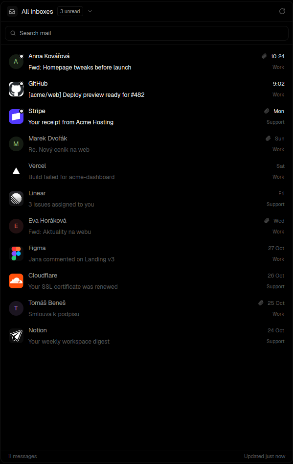

# Inbox for Herdr

A mail panel for [Herdr](https://herdr.dev) built on [himalaya](https://github.com/pimalaya/himalaya):
all your accounts in one list, fast reading, search, sender pictures, attachments, readable
forwards, and **Send to agent**, which pulls the actual request out of a forwarded mail and
hands it, with its attachments, to a coding agent you have running.



## Install

Ask your agent in Herdr: *"add the mod at github.com/ThatBlokeJosh/herdr-mail-inbox"*, or copy
`mods/mail-inbox/` into `~/.config/herdr-app/mods/` yourself. Then check it:

```sh
herdr-app check ~/.config/herdr-app/mods/mail-inbox
```

It docks on the right the first time Herdr sees it.

You need `himalaya` v2 with your accounts configured, `python3` and `curl`. For text copies
of Word, Excel, PowerPoint and PDF attachments, also `pdftotext` and LibreOffice.

Setup and options: [mods/mail-inbox/README.md](mods/mail-inbox/README.md).
How it's built: [RECIPE.md](RECIPE.md).
