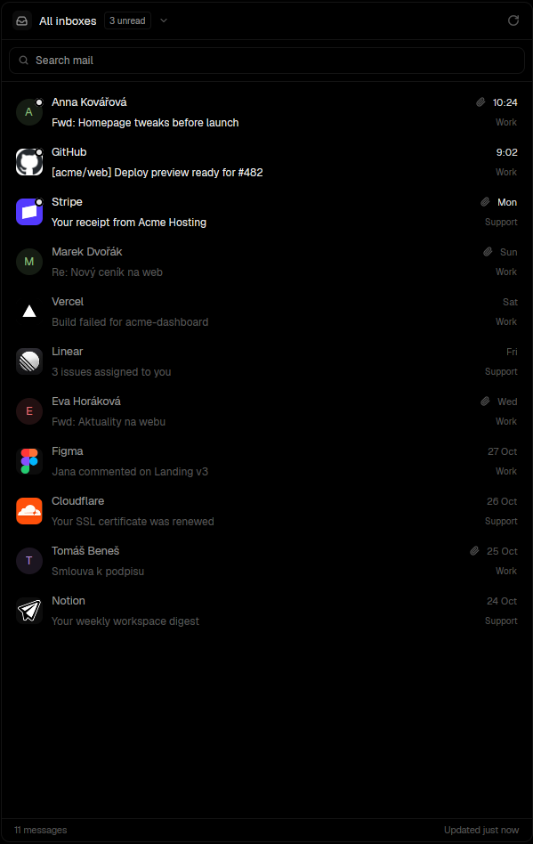

# Inbox

A mail panel for Herdr: every himalaya account in one merged list or one at a time, instant
reading from a local cache, server-side search, sender pictures, attachments with file-type
icons, forwards and quoted history drawn as cards, and **Send to agent**, which finds the
real request inside a forwarded mail ("pls fix" on top of a client's email) and pastes it,
with the attachments' paths, into a running coding agent.

## What you see

The panel is one column (docks right at 380 px; any width works), a rounded card on the
theme's `background` with a 1 px `border`, 13 px UI text.

- **Header, 42 px.** In the list: the account switcher (22 px account picture or the
  "inboxes" icon, the view's name semibold, an "N unread" pill with a 1 px border, a
  chevron), then the refresh icon on the right (14 px, `dim`, `foreground` and spinning once
  every 900 ms while checking). In a message: a back arrow, the view's name, a
  **Send to agent** button (26 px, robot icon) and refresh. In the hand-off: back arrow and
  "Send to agent".
- **Switcher menu**: a 260 px popover with "All inboxes" (and how many accounts), a divider,
  then each account: 26 px picture, label, address, unread count in an `accent` pill, a check
  on the shown one.
- **Search bar**, 30 px tall in an 8 px band: search icon, the input, a clear (×) button
  while there is text. Its border turns `accent` while typing.
- **Message rows**, 56 px: a 30 px sender picture (Gravatar, else the company's site icon on
  a rounded `raised` tile, else a tinted letter in one of six ansi colors picked from the
  address), an `accent` dot on it when unread; the sender (semibold when unread), a paperclip
  when there are files, the date (time today, weekday this week, "18 Oct" this year); the
  subject; in the merged view the account's label under the date. Unread rows are
  `foreground`, read ones `muted`/`dim`.
- **Loading**: skeleton rows pulsing their opacity, never a blank panel. Errors show as a card
  with the message in `blocked` and a "Try again" button.
- **Status bar**, 26 px: "30 messages" or the search's result count, and "Updated 3m ago" or
  the search syntax hint.
- **Reader**: the subject (15 px semibold), the sender with a 34 px picture, address and full
  date; the attachments as chips (34 px: a 24 px tile with a file-type icon tinted by kind:
  PDF red, documents blue, sheets green, slides and archives yellow, images and video
  magenta, audio and code cyan, else grey; an image's own thumbnail; name, size, a save
  button). Then the body at 12.5/20 px: paragraphs, lists, links in `accent`, inline images
  sized to the panel, forwarded messages as cards with their From/Date/Subject, quoted
  history collapsed behind "•••", signatures small and `dim`. "Sent to Claude Code in web 2m
  ago" in `accent` once a mail has been handed off.
- **Send to agent**: the chain of messages in the mail (24 px picture, sender, date, first
  line, a "note", "request" or "earlier" badge; the request row highlighted), the request's
  text in a 170 px card, the attachments with checkboxes (and a "text" tag once a text copy
  exists), the running agents (26 px program icon, title, space and tab names, a status dot:
  `working`, `blocked`, `done`, `idle`), the best match outlined in `accent`. Pinned at the
  bottom: "Note for the agent" (a growing textarea, prefilled with the notes) and a full-width
  `solid` button "Send to Claude Code in web".

## How it behaves

- Lists come from a cache first (the last 30 per account), then from the server; every
  account refreshes every 60 s. Each himalaya call is cut off after 20 s, and a stuck call
  never blocks later ones. "Load older" pages 30 at a time; in the merged view it loads the
  account holding the list back.
- Message bodies are read once ever and kept on disk with their attachments. The newest 12
  are read in the background after each refresh, hovering a row reads it, so opening is
  instant. Opening marks it read.
- Search waits 350 ms after typing, searches every shown account on the server (100 newest
  matches), and meanwhile filters what is loaded. Syntax: `from:`, `to:`, `subject:`,
  `body:`, `is:unread|read|flagged`, `after:`, `before:`, `on:` (dates are checked locally).
- Clicking an attachment opens it with the desktop's app; the arrow copies it to
  ~/Downloads (adding " (2)" when taken). Clicking a link opens the browser.
- Escape closes the hand-off, then the message, then the search.
- Send to agent: the request is the first message in the chain that isn't a note. Notes are
  the team's messages (your accounts' addresses and their company domain, plus `team` in
  config.json) and anyone's few words (under 280 characters) on top of a forward. Clicking
  another row makes it the request and refills the note. Running agents are ranked by how
  much the mail talks about their space (sites it links, the sender's domain, the space's
  name, where this sender's last mail went). Send writes `mail.md` (request, notes, files,
  earlier thread) next to the attachments, pastes the prompt into the agent with `hc send`,
  and focuses it.
- The prompt: the note, "Request from <sender>, <date>, "<subject>":", the request's text
  (cut at 6000 characters with a pointer to mail.md), the attachment list with their folder
  and text copies, and a pointer to mail.md for the rest of the thread.

## Built from

- One mod, `mods/mail-inbox/`: `main.js` (the panel), `body.js` (parses a mail's text into
  blocks: paragraphs, lists, quotes with their "On … wrote:" line, forwards with headers in
  English and Czech, signatures, links, image placeholders; and finds the chain of
  messages), `context.js` (the prompt, mail.md, agent ranking), `read.py` (runs
  `himalaya message read --json`, writes attachments to disk and a slim `message.json`, so
  big files never go through `exec`), `extract.py` (text copies: pdftotext, LibreOffice for
  Word, every sheet of a spreadsheet as CSV, slides through PDF), `avatars.sh` (Gravatar,
  then Google's favicon service for company domains; misses retried after a week), and
  Lucide-style SVG icons (`ft/` for file types).
- `herdr`: `exec`, `hc`, `run("pane.focus")`, `agents()`, `spaces()`, `theme()`,
  `notify`, `readTextFile`, `writeTextFile`, `appHome`, `home`. gpui-base: `Popover` (the
  menu: its own layer, so clicks never fall through to rows), `InputState`/`Input`,
  `TextareaState`/`Textarea`.
- Programs: `himalaya` (v2, JSON output), `python3`, `curl`, `sh`; optional `pdftotext`,
  `soffice`; `timeout` or `gtimeout` when present; `xdg-open` or `open`.
- Data under `~/.config/herdr-app/data/mail-inbox/`: `files/<account>-<id>/` (message.json,
  attachments, text copies, mail.md) and `avatars/`.

## Watch out

- himalaya's `envelope list --json` is `{queued, envelopes}`; `envelope search` ignores
  `order by` (sort results yourself); some IMAP servers reject date clauses, so dates are
  filtered locally; attachment ids are the part index + 1; `message read --json` carries
  attachments as byte lists, too big for `exec`'s output, hence read.py.
- Never call himalaya without a time limit: one hung call behind a "loading" flag freezes
  the panel for good.
- `line_height` takes a string ("20px"); a number is a multiple.
- A textarea scrolls its scroll container to its caret: keep the note out of the scrolling
  part, or the request scrolls away when it's filled.
- Elements are single use: build a fresh icon for each place it's drawn.
- AnonAddy aliases (`alias+user=domain@…anonaddy.com`) are shown as the real sender.
- Nothing personal in code: accounts come from himalaya's config.toml, the team from the
  accounts. `config.json` (optional) can set `accounts`, `team`, `refreshSeconds`,
  `himalayaConfig`.
- The cache under data/ is never cleaned up.

## Done when

- With himalaya set up, the panel lists the newest 30 mails of every account within a
  couple of seconds, and the second start shows them at once from cache.
- The switcher menu changes the view, and clicking in it never opens a mail beneath it.
- Typing `from:github` finds older mails from the server, sorted newest first.
- A forwarded mail shows the forward as a card with its headers, quotes collapsed, and its
  attachments as tinted chips at the top; clicking one opens it.
- On a forward with "pls fix" from a teammate, Send to agent marks the client's message as
  the request, fills the note with "pls fix", and after Send the agent's terminal holds the
  prompt with the request's text and the attachment paths, and mail.md sits beside them.
